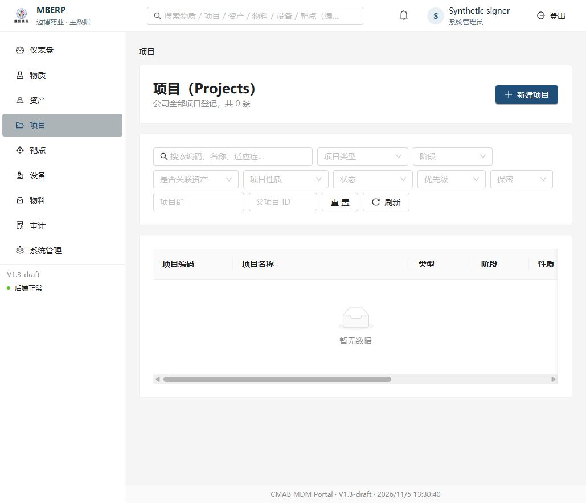
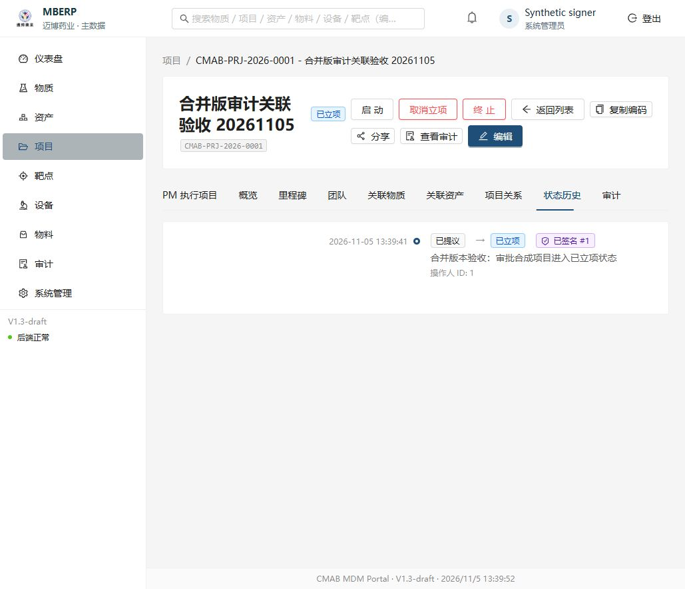
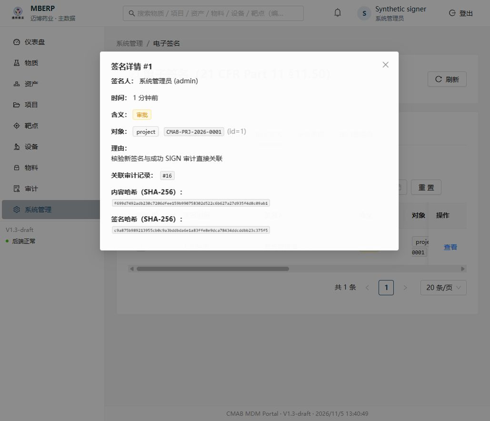

# 签名审计关联与全量类型检查修复

本文件为原生工程验证记录，不是 Word 设计文档的派生副本。仅验证本地隔离合成环境；不涉及 Maibo、真实账号、正式数据或部署。

## 修改边界

- 新电子签名先写入一条成功的 `SIGN` 审计，并在同一业务事务中将其 ID 保存到 `e_signature.audit_log_id`。审计包含操作者、对象、签名含义、独立签名理由、时间、内容/签名哈希和认证方式，不记录密码或认证令牌。
- 原有密码验证及 OIDC 新鲜认证、主体/会话绑定、一次性挑战和业务权限保持执行。成功审计不走独立提交；业务事务回滚时，签名和成功审计一起回滚。已知未提交失败与提交结果不确定应区分，不能据网络异常推断数据库未提交。
- 不新增数据库迁移、不回填历史、不改变旧签名哈希。新 API 摘要提供可空的审计 ID，界面显示关联 ID；旧记录缺少关联时显示“历史记录未关联”。
- 全量 `mypy app` 从162项降至0项，覆盖127个源文件。保留原检查规则，未增加忽略诊断或排除模块。Pydantic 官方插件启用类型化初始化；移除覆盖 Redis 原生类型的旧 `types-redis` 及其三个专用传递 stub，其余锁定版本不变。
- 使用 TypedDict 明确种子定义与导入统计结构；修正真正缺失的类型导入、变量复用与数据库结果边界。持久化字符串进入 Literal 响应字段时继续由原 Pydantic 模型实际验证。没有运行真实导入、demo 或真实库 seed。

## TDD 与回归

1. 基线 `75cb755` 实际复现162项全量 mypy诊断。
2. 新增新鲜认证业务测试的直接审计关联断言，初次因 `audit_log_id is None` 失败；实现后通过。首轮 Compose 相对挂载配置失败不算业务 red，修正挂载后的断言失败才是 red。
3. 增加新签名关联、成功记录原子回滚、独立签署不共享审计记录、历史空关联不回填、API 摘要兼容的隔离数据库测试。既有取消、过期、重放、内容变化及失效会话拒绝继续保留。
4. 身份/项目/签名397项回归通过；前端55项单测、严格 eslint、TypeScript/Vite生产构建通过。
5. 扩展领域回归首轮170通过、1失败，捕获本轮字典整理导致的物料引用列表问题。已修正为从 SQLAlchemy 的行序列构造字典，强化该接口200断言，并将11组受影响领域回归纳入同一CI入口；本地扩充后的568项全部通过。
6. API 类型通过实际应用的 OpenAPI 和官方 `openapi-typescript` 生成，未手改生成文件；同时补齐主线既有 OIDC/PM 接口的生成类型，不表示本轮新增这些业务接口。
7. 最后补充的3项聚焦验证通过：在业务提交前注入明确失败后，OIDC挑战回到ready且未绑定签名，业务状态、签名和成功SIGN审计全部回滚；另外核验原生兼容/历史空关联保留及物料引用列表。该故障注入为数据库集成测试，不是浏览器认证证明。

`type-refactor-integrity.json` 保存11组种子常量的 AST 哈希对照及锁定版本对照；没有复制任何账号密码或导入业务数据。
`dto-refactor-integrity.json` 核对15处响应边界，字段及取值表达式与基线一致，保留原模型的运行时验证。

## 可重复执行

在仓库根目录运行：

```sh
docker compose -p mdm-audit-types-ci -f cmab-mdm-platform/deploy/docker-compose.phase1-test.yml up --build --abort-on-container-exit --exit-code-from tests
docker compose -p mdm-audit-types-ci -f cmab-mdm-platform/deploy/docker-compose.phase1-test.yml down -v
docker build -f cmab-mdm-platform/deploy/test/frontend.Dockerfile cmab-mdm-platform/frontend
```

该 Compose 是新建、无固定卷名、无宿主发布端口的测试环境，使用空 tmpfs PostgreSQL与独立 Redis。测试入口验证 `TEST_DB=cmab_test`、`TEST_DB_HOST=postgres`，通过 `run_tests.sh` 重建的仅为该新测试库。不要将这些命令改成 dev 或共享库配置。

CI入口 `backend/scripts/run_phase2_tests.py` 保留原检查并新增完整 `mypy app` 和受影响领域回归；不降低测试、覆盖率或认证要求。

## 合并、主线 CI 与版本绑定

代码 PR [#6](https://github.com/OpenLimsAI/cmc-platform/pull/6) 于2026-11-05 05:14:27 UTC squash 合并为 `818529e157733593c227e5db08724af857bb74b6`。合并提交与已通过CI的PR head `18f996a` 源码树完全一致（`14eba64a2a395d84bcf0019fc7e83e7c57e355fd`）。合并后[主线CI](https://github.com/OpenLimsAI/cmc-platform/actions/runs/41972752422)的 `mdm-backend`、`mdm-frontend` 均成功；原始精简回执见 `merged-e2e/code-main-ci.json`。

真实浏览器验收固定 MDM 上述合并提交、PM `1b21df69f7dca0b3558db2de74e5045b6ba78163`、IAM `72ebcb4d7c0aedecd7ca56a29fbb37b78c85c6c1`。PM从已验证的 `3292930` 到该提交仅有文档更新，`backend/app`、`src` 及依赖锁无差异。IAM由精确受版本控制的源码/补丁重新构建，映像ID和可执行文件指纹与已验收v11一致；详见 `source-versions.json`。本次报告补充不改变这三端业务代码。

## 合并后真实浏览器验收

2026-11-05 05:29–05:45 UTC，在ThinkPad独立空库与两名合成用户中，通过真实浏览器运行正常登录和业务流程，没有使用mock、依赖替换、注入登录Cookie或关闭鉴权。截图页面时钟显示UTC+8，索引统一使用UTC。运行入口仅为 `127.0.0.1:19192` 门户、`:19190/mdm/`、`:19191` PM和`:19181`身份服务；原 `localhost:190xx` 体验环境保持运行，避免共用Cookie。

| 场景 | 实际结果与证据 |
| --- | --- |
| 门户密码登录→MDM SSO | 合成signer从正常门户密码表单登录，点击主数据入口后免重复输入进入真实项目页；截图01、02。 |
| 登记项目→创建PM执行项目 | 真实表单明确选择产品、当前/目标阶段、PM负责人和计划日期，创建 `CMAB-PRJ-2026-0001` 与 `E2E-AUDIT-20261105`，严格一对一；截图03、04和 `business-final.json`。MDM、PM保留独立ID及状态权威。 |
| 同账号显示与角色 | 两端都显示 `Synthetic signer`；MDM显式映射数字用户1/系统管理员，PM为项目负责人。并非由PM角色自动授予MDM权限；历史审计仍保留MDM本地身份 `admin`。 |
| 取消认证 | 签名弹层打开后取消，理由/主页面保留；项目仍proposed/v1，签名、成功SIGN审计和状态历史均为0；截图05、06和 `audit-after-cancel.json`。 |
| 错误密码 | 在真实身份服务弹层提交错误合成密码，DOM读取到“登录失败: 密码错误”及剩余次数；状态、签名和成功审计无变化。提示为瞬时通知，截图07–10未清楚捕获该文案，不能把这些图片当作可读错误提示图证；有DOM实际观察和前后DB断言，见 `audit-before-success.json`。没有锁定账号或重置密码。 |
| 挑战过期 | 测试期间挑战自然过期，页面明确提示重新认证并保留表单；截图11。没有修改系统时间或放宽有效期。 |
| 新鲜密码验证→明确签署 | 新挑战要求输入统一身份密码，身份服务验证成功后仍需明确点击“确认签署并提交”；截图12。随后审批成功，项目initiated/v2，状态历史显示“已签名 #1”；截图13。MDM不接收或保存身份服务密码。 |
| 直接审计关联 | 真实对象审计展示独立SIGN与UPDATE、各自理由；签名详情直接展示审计 `#16`，截图14、15。DB证明签名1→SIGN审计16，操作者/对象/内容哈希/签名哈希全部一致，且同一签名关联1条状态历史及1个已消费挑战；见 `audit-after-success.json`。 |
| 应用进程重启与刷新 | 仅重启本轮MDM/PM应用进程；原会话、执行项目、签名1与审计16保持可见；截图16、17。最终仍只有1个签名和1条成功SIGN记录，没有因刷新重复写入。没有以此声称验证了数据库或IdP重启。 |
| PM退出后的边界 | 点击PM“登出”后，门户刷新回到登录页；MDM会话接口真实401并跳到身份服务登录页；截图18、19及无查询串HTTP状态日志。此结果仅覆盖当前合成用户的本次浏览器会话组合。 |
| 只读身份 | 另一合成用户正常密码登录后显示只读角色；签名接口真实403，项目可读但状态变更按钮禁用且无编辑入口；截图20、21。直接打开管理签名路由仍显示空列表而不是完整403说明，这是既有前端错误呈现限制，后端未泄露签名记录。 |
| MDM本应用退出 | 只读用户退出后，MDM明确提示“已退出本应用”，再次SSO需主动发起；截图22。不将该动作宣称为所有设备全局退出。 |

浏览器工具的高层iframe点击/回车出现目标失效，密码填值和页面观察可用；按公开开发工具文档，使用当前截图定位的普通鼠标输入完成身份服务按钮点击。没有修改页面脚本、存储、认证状态、暂停请求或安全策略。该交互不能描述为一次性无人值守脚本复跑；服务初始化、清理和数据库断言为可重复工程工具，浏览器步骤由受支持工具自动执行并核对。

### 关键实际画面







### 证据与环境清理

`merged-e2e/screenshot-index.json`列出22张实际截图的场景、UTC时间、无查询串地址和SHA-256；`screenshot-integrity.json`确认全部文件可解码、22个哈希均不同。截图仅含合成身份/项目和掩码输入，不含密码、Cookie、Token、客户端密钥或真实账号资料。未提交环境变量、原始会话、密文fixture、日志请求体或私钥。

`http-status-only.txt`只保留时间、方法、不带查询串的路径及状态码。成功审批请求为200、只读签名列表403、退出后的会话401；身份服务业务密码错误使用HTTP200，不能只凭HTTP200判为认证成功。DB证据只输出一致性布尔断言，不包含认证材料或密码哈希。

首个新环境因PM现有多个Alembic head失败，确认空库无业务表后已销毁8容器/1网络。第二个新环境采用PM文档支持的 `python -m app.db.upgrade --schema-only`（运行驱动显式 `runtime.pm_schema_owner_tool=True`）；不改PM迁移历史，不对已有数据库执行重建。191xx全程仅回环绑定，使用9个新临时容器、2个网络和tmpfs空库。05:47:03 UTC全部清理，容器/网络无残留、四个端口均空闲；凭据随tmpfs销毁，驱动清除内存引用。见 `cleanup-receipt.json`。原190xx用户体验环境不在清理范围。

### 覆盖限制和发布边界

- 跨主体、回调重放、内容版本变化、失效会话和提交失败原子回滚由真实隔离数据库集成测试覆盖；本轮没有将这些全部重新构造成浏览器攻击用例，不能与本轮浏览器取消/错误密码/自然过期混称。
- 新空库没有真实历史签名；“旧NULL关联不回填”的证明来自独立兼容测试，不是假定新空库可以证明生产历史完整性。
- 未运行MFA、SMTP/找回密码（用户已排除），未操作真实用户改密或Maibo；未复做完整v3→v4生产数据库演练。本次无服务器部署、IAM升级或生产安全回退。
- 官方v4原版改密后的旧IAM Cookie撤销差异仍需维护补丁；本轮使用mb-casd维护版本，不代表官方原版已修复。正式升级仍需单独授权、备份恢复与环境验收。
- 本次是研发原型的本地合成验收，不构成GxP/GMP或电子签名法规合规认证。
