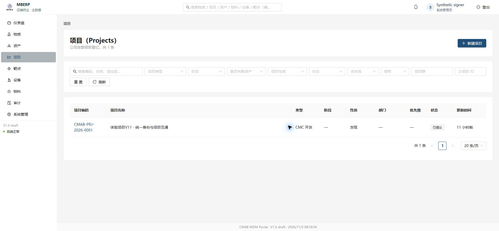
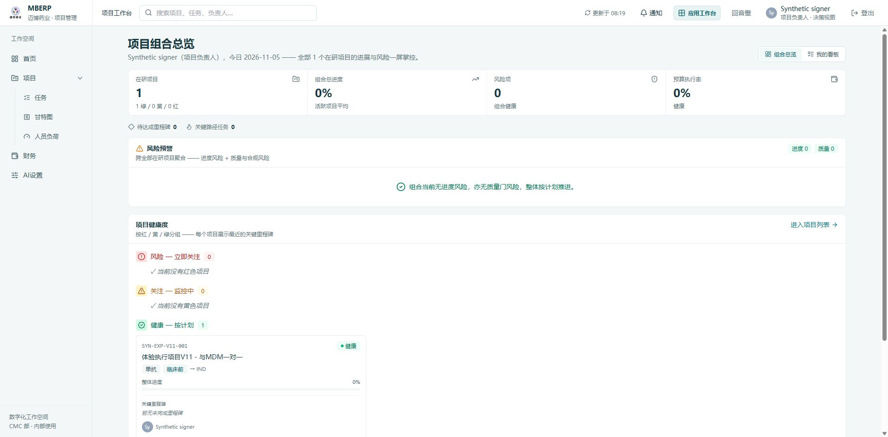
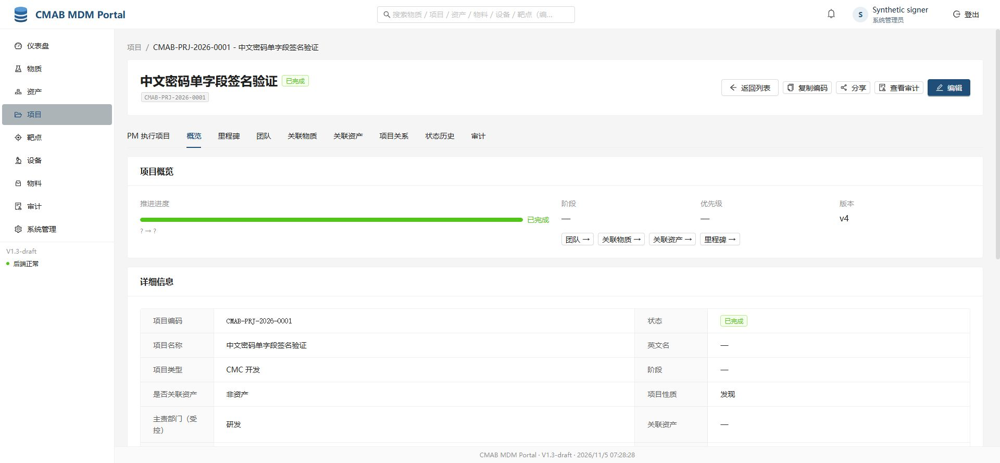
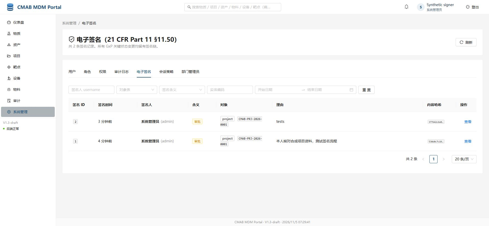
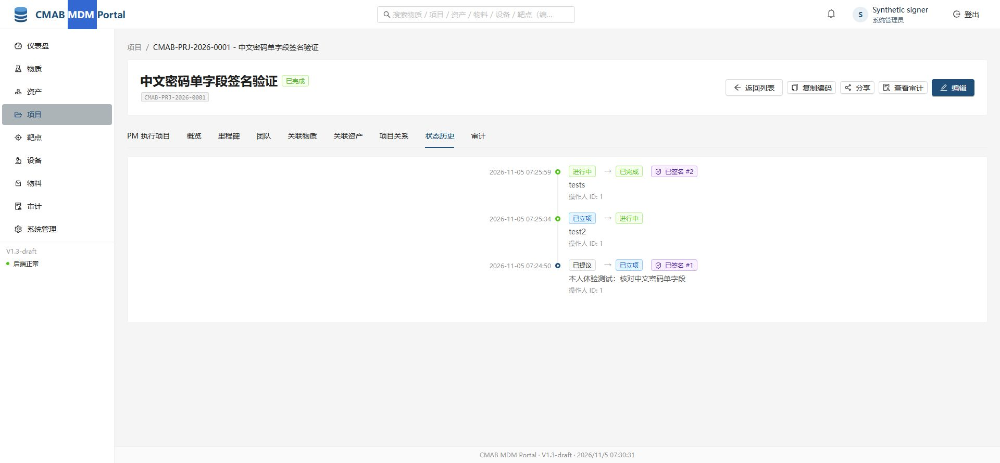

# 新鲜认证签名与身份展示候选验证

记录时间：2026-11-05T01:56:18.686902+00:00。基线 f01577207b50dcecbd02b038afb4301437359834；新增monitor提交与MDM无路径重叠。采用独立候选，未覆盖原工作区旧启动/部署材料，未重发停止的fc80304方案。

本轮最终隔离后端396通过，Ruff通过、相关10文件mypy及bootstrap严格类型检查通过；前端55单测、eslint零告警、tsc和Vite生产构建通过。新fixture profile测试先因函数不存在失败；实现后通过。搬入既有签名表单测试时的import/zip lint失败已修正，未改变规则。

MDM业务app与frontend/src相对此前已验收本地候选未再修改；整理增加的是测试profile、纯合成签名表单配置及测试。旧全量mypy162项有同镜像干净908基线逐条对照，本次app源码相同，沿用该证据，未冒称全量绿。

## 历史真实浏览器证据（非本轮新截图）

筛选的五图均实际打开检查，无密码、Token、Cookie、客户端密钥，大小/哈希与原捕获记录一致，索引在[screenshot-index.json](screenshot-index.json)。原始私有fixture、交付文件及运行目录没有复制。截图UI中的法规字样是原型现有标签，不代表法规验收。

两图同为Synthetic signer，业务角色分别系统管理员/项目负责人，没有同步或提升角色。原190xx项目及PM关联保留。该PM图不是最新eced013组合的浏览器证据。

签署分别发生11-04 23:24:50、23:25:59 UTC，由用户本人输入测试密码；项目completed/version4，挑战consumed、同issuer/subject与新鲜auth_time可核验。后3图是在Header品牌替换之前，不能冒充新Header或密码输入页面。没有输入当时截图；不称无人值守签名通过。

## 审计与安全边界

两条签名audit_log_id仍NULL，基线同样未回填。状态历史e_signature_id与挑战signature_id可追踪，不等于成功SIGN直接审计外键完整。本轮没有猜日志、回填历史或隐藏缺口。建议另行TDD补新签名事务确定关联及并发/回滚测试。

0069新增挑战证据表，保留旧数据/用户ID/审计；有记录时downgrade拒绝删除证据表。fresh模式默认不启用，身份服务独立受众与新鲜证明、同主体/内容/意图/一次性消费仍严格校验。MDM不收身份服务密码。原生兼容模式未被无声删除。

E2E资产是受支持CUA分阶段驱动，完整浏览器未接入GitHub CI，仍需已验收固定镜像缓存及操作时批准。受控iframe曾暂停，未强制放行；此前被拒的签名代输未重试。最终密码单字段需显式新fixture选项，不会修改已有体验客户端。MFA/SMTP找回密码/真实用户/第二真实设备/正式迁移未验收。

实际当前main合并后的整条门户→MDM→PM→签署浏览器验收和正式开启条件仍属后续门槛。原190xx体验按用户要求保留，独立191xx已在原期限清理；本轮新回归资源另按ID清理，不停用户环境。

机制见[设计边界](../../decisions/2026-11-05-oidc-fresh-signature.md)，复跑见[浏览器资产](../../../frontend/e2e/README.md)。

本轮是隔离本地候选与工程回归，不是 Maibo 发布。代码启用、安全配置和生产迁移是不同动作；没有配置正式凭据或权限。后续提交/PR/CI/合并结果需追加，不能用本地测试代替远端检查。
