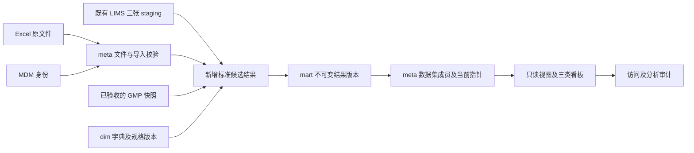

# QAP-DDM-001 质量分析平台数据模型详细设计

| 项目 | 内容 |
|---|---|
| 版本 | V2.1 评审草案；沿用原文件名，避免旧链接失效 |
| 日期 | 2026-09-16 |
| 状态 | **正式模型设计，尚未建表、迁移数据或部署** |
| 范围 | 现有 QAP 续建：放行分析、稳定性、相似性、员工 Excel 导入 |
| 配套 | [实施与迁移清单](QAP-DB-IMPLEMENTATION-001.md)、[核验记录](QAP-DB-REVIEW-20260916.md)、[系统架构](QAP-SAD-001_v2_0.md) |

## 0. 依据与边界

依据父级 AGENTS.md、CLAUDE.md、[白皮书 V0.4（含 D13）](../../CMAB_Data_Architecture_Whitepaper_V0_4.md)、修订清单、中央迁移 README/SOP，以及本项目实码。结构发布唯一入口是 `cmc-schema-migrations`。

本次以代码和本机只读查询修正旧文档；Linux 正式/培训库沿用负责人提供的 2026-09-16 快照，**本轮没有连接 Linux**。原 V2.0 完整保留在 [归档](./_archive/QAP-DDM-001_v2_0_before_20260916_formal_design.md)。历史“纯只读、无导入、无需迁移”方案由本次授权的“查询只读 + 独立受控导入”替代，raw/主数据边界不变。

已决定：使用 `cmc_analytics`；业务批号 `batch_number`，值不变，不新增同义 `batch_id`；保留共享 staging 和其他系统内部数字主外键、raw 原字段；MDM 是唯一登录身份来源。下文所有新对象均是**拟新增、待实施**。本轮没有执行 DDL/DML、创建账号、授权或写中央迁移链。

代码增量见 [开发记录](QAP-DEV-LOG-20260916.md)：batch_number前后端适配、XLSX结构预览接口/页面及MDM验签/会话代码已完成；真实身份配置待联调，本设计的新数据库对象仍未实施。

当前代码补充：两页可切换共享 staging 中 RD 和旧 QC 来源，继续复用原表；未把 QC 历史映射当作正式 GMP 模型。旧 quality Excel 数据仍未接入，当前应用账号缺读取权限，详见 [来源接入记录](QAP-DATA-SOURCES-001.md)。以下新增正式模型仍是待实施目标。

## 1. 现状、复用与新增

| 对象/能力 | 现状 | 处理 |
|---|---|---|
| `staging.stg_sample/stg_test/stg_result` | 本机主键均为 `(source_system, source_id)`，现有 QAP 直接 JOIN；跨环境一致来自交接快照 | 原样复用为 LIMS 输入；不改名、不删除、不混入 Excel 数据 |
| `dim.method_master` | 已存在，PK=`method_code VARCHAR(32)`，没有 `method_id` | 只读复用；不另建方法字典、不改主键 |
| `dim.employee_master` | LIMS 业务人员字典，非登录账号 | 可用于检验人员展示，不作登录/权限/操作人外键 |
| `dim.equipment_master/channel_dict` | 已有采集映射/通道字典 | 按需只读；设备台账权威仍在 MDM `eqp.equipment` |
| `mart.dim_batch` | 来源是 `staging.stg_batch`，含工艺 `batch_key` | 不重建，不作为全部质量结果的强制 FK；先核验关联粒度 |
| 既有 `mart.v_*`、`fact_*`、`manual.sample_result` | 其他应用在用；manual 为培养日指标粒度 | 保留，不强行改成质量平台事实层 |
| `quality.quality_data/import_history` | 本机旧兼容表：84,757 条结果、14 条导入历史 | 保留；将来显式回填为 legacy 来源，不宣称历史追溯完整 |
| 检测项/单位/规格字典、正式质量事实层 | 本机未建；Linux 未建来自交接 | 按本方案新增 |
| `meta/snap_mdm/snap_gmp` | 本机无表 | 本期建必要 meta；快照管道另行实施，不能声称 GMP 已接通 |
| 放行 API/页面、统计函数 | 原型已有；规格 Python、映射/分类 CSV；另外两页占位 | 保留基础，业务批号契约已适配；后续切正式数据层 |
| Excel 页面、MDM 验签/权限、员工审计 | 结构预览页面/API、验签/角色及会话代码已有；真实身份联调和持久审计未实现 | 依本方案推进正式导入，不能以旧 Streamlit 能力当作已实现 |

本机 `stg_sample` 有 5 条批号 >32 字符、73 条缺失。目标类型不允许截断历史值：保留原值、记校验问题、阻断相关正式发布，不直接 ALTER 源列。结果→检测→样品关联孤儿计数为 0，仅代表本次本机快照。

## 2. Schema 归属与流向

所有分析对象在同一 `cmc_analytics`，不新建质量数据库、`qap_config` 或 `app_unified`。

| Schema | 本期目标 | 维护责任 |
|---|---|---|
| `dim` | 检测项、单位/转换、来源映射、类别规则、规格版本、稳定性方案 | 中台受控维护，业务负责人确认内容；普通上传者只读 |
| `staging` | 新增 `stg_quality_result`，跨来源的版本化标准候选结果 | 受控转换服务；不写既有 LIMS 三表 |
| `mart` | `fct_quality_result` 不可变观察版本，以及当前/放行/稳定性视图 | 受控发布写事实，分析账号只读 |
| `meta` | 文件、导入批次、校验问题、事件、血缘、数据集、分析运行、访问审计 | 导入/发布/审计职责分离，不混写其他应用审计表 |
| `snap_mdm` | 后续按需提供项目/产品等权威引用的版本快照 | MDM API/中台同步，不由上传者维护 |
| `snap_gmp` | 后续 GMP 快照、版本、截止点 | 中台管道，验收后接入；不直接连 GMP raw 分析 |
| `quality` | 仅旧看板兼容对象 | 保留消费者，不扩为新字典/事实/账号中心 |

原文件放受控文件区/对象存储，数据库保存定位键、hash、留存状态，不新建 raw 库。来源分别为 `rd_samplemanager`、`excel_upload`、`legacy_quality`；未来 GMP 来源仅由已验收快照管道登记。Excel 填写的“QC LIMS”仅是 `declared_source`，不能自动变为 LIMS 权威记录。

## 3. 通用字段和关联

新表默认 `<entity>_id BIGINT GENERATED ALWAYS AS IDENTITY`；业务编码 `VARCHAR(32)`；标准批号 `batch_number VARCHAR(32)`；SHA256 为 64 位十六进制并加 CHECK。新增时间戳 `TIMESTAMPTZ`，UTC 保存；源无时区时间另存原文，时区未确认不得自动解释为 UTC。数值 `NUMERIC`，具体精度/舍入按检测项确认，拒绝非有限值；源 double 的精度局限保留，转 NUMERIC 不代表测量精度增加。

员工字段取服务端验证的 MDM JWT：`actor_username/actor_full_name` 字符串快照；上传、确认、更正分别记录。`actor_type=employee/service/legacy_unknown`，后台另记 `service_name`；数据库账号另作技术执行人。按总纲 §8 下游规则，不建用户表、不保存密码或令牌、不建 MDM 跨库外键、不拿 LIMS 人员表当登录表；旧历史无法确认员工时不得补造身份。

新对象间用真实 FK，历史引用 `ON DELETE RESTRICT`。MDM 权威编码、LIMS 原键是外部引用，保留来源并校验，不改变共享表约束。业务批号不是结果唯一键；同号跨项目/来源的唯一性尚未确认，禁止只按批号 JOIN 后导致记录倍增。不解析批号猜项目、批准状态或年份作为检测日期。

## 4. 维度、单位与规格（目标）

### 4.1 检测项及单位

| 表 / 粒度 | 字段（通用 ID/审计字段从略） | 约束与规则 |
|---|---|---|
| `dim.test_item_master` / 一个稳定检测项定义 | `test_item_code/name`、`value_kind`(numeric/text/censored)、`quantity_kind`、`canonical_unit_id FK`、`status` | code 唯一，显示名非唯一；数值/限定数值必有标准单位，无量纲也显式指定；含义或标准单位改变另建版本/检测项 |
| `dim.test_item_source_map` / 一个上下文映射版本 | `source_system`、`source_attribute`、`source_method_code`、`scope_info JSONB/scope_hash`、`test_item_id FK`、`mapping_version`、有效期、状态、批准依据/人/时 | 来源+方法+适用项目/模板等上下文精确匹配；不能仅按“主峰”原名统一；规则族+版本唯一 |
| `dim.test_type_rule` / 一个检验类别规则版本 | 来源、`source_test_type`、scope、`analysis_category`(release/stability/other)、`rule_version`、有效期/批准信息 | 未确认保持 unknown；分类不能解释成批准放行，关键词只可作为建议 |
| `dim.unit_master` / 一种明确含义的单位 | `unit_code`、`display_symbol`、`quantity_kind`、`scale_convention`、经批准的来源别名/格式规则、`status` | code 唯一；比例小数与百分数点值分开定义；空单位不视为无量纲 |
| `dim.unit_conversion` / 一项限定上下文的转换版本 | `from_unit_id/to_unit_id/test_item_id FK`、scope、`factor/offset NUMERIC`、`conversion_version`、有效期/批准依据 | `y=x*factor+offset`，factor>0；本期只支持经批准的固定线性换算；需要逐条密度/体积等外部参数的转换暂阻断，待另设参数来源/数值快照后支持；禁止依 is_pct 自动 ×100 |

标准化输出单位由检测项 canonical_unit_id 决定，不按同组第一行或临时规格猜测。Excel 的底层数值、显示文本、number_format（如百分比格式）与来源模板版本均保留在 source_payload；显示为百分比不自动证明底层值是比例，按批准的模板/来源规则解释，冲突阻断。涉及身份、单位或比较规则的历史定义不可原位改写。

规则发布时锁定同族规则并检查有效期冲突；采用 `[valid_from,valid_to)`。历史引用的内容不得原位改写，新建版本；生命周期调整须审计。零匹配/多匹配均产生问题，不取第一条。未知、缺失和“不适用”是不同语义，scope 不得用 NULL 暗示任意通配。

方法复用 `dim.method_master(method_code)`，保留源方法码/名称。现表没有科学方法版本，不能用 updated_at 伪装；结果另存方法名称快照和已知 `source_method_version`。未知/过长方法码保留原文并产生问题，不让上传者顺手创建主数据。

项目/产品引用 MDM 编码/API/版本快照；保留原始 `project_id/source_product_ref`（project_id命名依据下文第一表修订）。`009`、`009_2`、`CMAB009` 是否相同需确认，不能照搬代码后缀回退。当前没有就绪的通用 MDM 快照；不重复创建项目/物质权威表、不拿 `batch.mdm_project_snapshot` 当 QAP 可写字典。无法解析的项目保留在候选层，依赖它的规格匹配暂停。

### 4.2 规格头与限度明细

| 表 / 粒度 | 字段 |
|---|---|
| `dim.spec_master` / 一份规格的一个适用范围及版本 | `spec_id`、`spec_code VARCHAR(32)/version_no INT`、MDM `project_code/product_code`、`sample_type_code`、`analysis_category`、`scope_info/hash`、`valid_from/to`、`date_basis`、`status`(draft/approved/retired)、`document_ref/document_sha256`、批准人/时、`supersedes_spec_id FK` |
| `dim.spec_limit` / 规格版本×检测项×方法适用范围 | `spec_limit_id`、`spec_id/test_item_id/unit_id FK`、`method_code`、`method_scope`、`limit_kind`(range/lower/upper/text/no_limit)、`lsl/usl NUMERIC`、`lsl_inclusive/usl_inclusive BOOL`、`accepted_text JSONB`、`rounding_rule JSONB`、`comparison_rule_version` |

约束：`UNIQUE(spec_code,version_no)`；规格内检测项+方法范围唯一；双限 `lsl<=usl`；单侧、文本、无规定限度按 kind 校验所需字段。`no_limit` 要明确依据，不能代表“没有找到规格”。规格范围需明确产品/项目、样品类型、稳定性阶段/条件等；适用日期究竟按检测、生产或其他日期匹配待业务确认，不能随意用上传日期。

批准后内容/依据冻结；新版本另起记录。停用/关闭有效期只能由主数据发布事务执行并留事件，不改变已发布事实绑定的规格版本。同 scope 已批准有效期不能重叠；通用与专用方法规则同时命中也必须检出。单位确认并转换后才比较；无规格、单位不明、日期依据缺失、多规格命中等为 `not_evaluated`，**不是合格**。

Python 内现有规格只能导出为待核对清单，不直接作为 approved seed。规格限度、统计控制限、相似性等效界值分别管理，不混用。

### 4.3 稳定性方案

拟新增 `dim.stability_protocol`，每行方案的一个版本：`stability_protocol_id`、`protocol_code/version_no`、项目/产品、`storage_condition_code`、温湿度范围及单位、包装/放置方向/试验类型、`planned_timepoint JSONB`、`timepoint_unit_id`、文档引用/hash、有效期、状态和批准信息。多条件方案的子记录粒度按真实模板确认后固化 DDL。

每个结果保留研究号、批号/子批、方案版本、条件、取样单元、重复编号、标称时间点、实际取样/检测时间。月/日不按固定比例默认换算；冻融次数/应力循环不是时间；`group_id` 不自动当储存条件或相似性参考组。

## 5. 质量结果模型（目标）

### 5.1 粒度与版本身份

**一行 = 一个来源观察结果的一次不可变版本**。同批次同检测项允许多个样品/方法/时间点/平行测定/复测/更正。禁止 `UNIQUE(batch_number,test_item_id)`，禁止无规则取均值、最新值或第一条。

- LIMS 身份 `(source_system,result.source_id)`，保留 sample/test/result 三键。sample/test/result 任一分析相关内容变化都需重新规范化，不能仅看 result.updated_at。
- Excel 为观察分配稳定 `source_record_key` UUID（非批号），更正显式引用旧观察键/结果号。文件名、行号不是永久业务身份。
- 同一来源观察版本及转换版本不可重复发布。A→B→A 是三次观察；hash 比较相邻版本内容，不作为全历史去重键。
- 接入后新增层保留观察历史；接入前已被上游覆盖的历史不能凭当前 staging 还原。

### 5.2 `staging.stg_quality_result` 字段契约

**2026-09-16 按负责人要求修正：以现有“项目第一表”为输入依据。** Excel 原始业务维度在候选层及事实快照中显式保留以下字段，供原值筛选，不仅塞入 JSON，不以内部数字主键代替：

| Excel字段 | 新模型来源字段 | 规则 |
|---|---|---|
| 请验日期 | `sample_submission_date DATE` + 原文/格式留 payload | 不是 received_at 或 authorised_at；无法解析保留原文并记问题 |
| 组别 | `group_id TEXT` | 原Excel组别，不替换成部门/公司 |
| 生产线代码 | `production_line_id TEXT` | 原Excel代码；归一化 production_line_code 另经批准映射 |
| 项目代码 | `project_id TEXT` | 原Excel项目码；代替此前Excel输入的 source_project_ref 命名。MDM project_code 仍为独立已核验引用，不能替换原码 |
| 样品类别 | `sample_type TEXT` | 原值；标准 sample_type_code 单独解析 |
| 原批号 | `batch_number VARCHAR(32)` | 原值不变；超长原文保留 source_batch_number 并阻断发布，不截断 |
| 检验类别 | `test_type TEXT` | 原值；analysis_category 通过批准规则产生，不按文件名冒充业务类别 |
| 放置状态 | `placement_status TEXT` | 显式筛选/稳定性分面维度；与储存条件、试验类别分开，不从其中推断温度 |
| 时间节点 | `timepoint NUMERIC` + 原文留 payload | 0是有效值；未知/文本不改成0，列出问题 |
| 时间单位 | `timepoint_unit TEXT` | 原单位；timepoint_unit_id 是独立字典引用，未匹配不改原单位 |

上述 project_id/group_id 等名称承载原业务编码，不是数据库 FK 或自增主键。旧设计 `source_group` 改由 `group_id` 承载，不新增两套同义来源列；`source_project_ref` 作为历史设计名称退出新Excel契约。任何其他来源的项目字段接入也应保留明确来源，不能与MDM编码自动等同。五列旧预览模板仅兼容保留，不是正式第一表模板。

| 字段组 | 字段与类型 | 空值/约束 |
|---|---|---|
| 身份 | `stg_quality_result_id BIGINT PK`、`source_system/source_record_key TEXT`、`source_revision INT`、`normalization_version TEXT` | 全必填；唯一(source_system,source_record_key,source_revision,normalization_version) |
| 来源 | `source_sample_key/source_test_key/source_result_key TEXT`、`source_payload JSONB`、`source_payload_hash CHAR(64)` | LIMS 三键必填；JSON 保存相关源字段；Excel 声明的 LIMS 键不表示已核实 |
| 作业与定位 | `import_batch_id/quality_load_run_id BIGINT FK`、`sheet_name TEXT`、`row_number INT`、`column_name TEXT` | import/load 恰有一个；Excel 必须定位 sheet/行/指标列，宽表拆成长表仍保留每格位置 |
| 批次背景 | `source_batch_number TEXT`、`batch_number VARCHAR(32)`、`project_id/source_product_ref TEXT`、`project_code/product_code VARCHAR(32)`、`production_line_id/production_line_code/group_id/sub_lot/sample_type/sample_type_code TEXT` | 来源业务维度按上表保留；MDM引用和标准化维度另校验；错误不得截断后发布 |
| 检测定义 | `source_attribute/source_unit/source_method_code/source_method_name TEXT`、`test_item_id/test_item_source_map_id FK`、`method_code VARCHAR(32) FK`、`method_name_snapshot/source_method_version TEXT`、`analysis_category TEXT`、`test_type_rule_id FK` | 未解析候选可空并记录问题；方法 FK 指现有 method_code |
| 结果 | `value_raw TEXT`、`value_num_raw NUMERIC`、`value_text TEXT`、`qualifier TEXT`、`source_unit_id FK`、`normalized_value NUMERIC`、`normalized_unit_id/unit_conversion_id FK`、`value_kind TEXT` | 保留 <、>、LOD/LOQ/定性；空不变零；文本结果允许无数值；公式原文/缓存信息留 source_payload，不执行宏或公式 |
| 日期 | `sample_submission_date DATE`、`source_time_info JSONB`、`source_timezone TEXT`、`sampled_at/tested_at/received_at/authorised_at TIMESTAMPTZ` | 不互相冒充；源时区或业务日期未定时不做依赖它的规格匹配 |
| 稳定性 | `test_type/placement_status/timepoint_unit TEXT`、`stability_protocol_id FK`、`study_code/storage_condition_code TEXT`、`timepoint NUMERIC`、`timepoint_unit_id FK`、`actual_elapsed_time NUMERIC`、`actual_elapsed_time_unit_id FK`、`replicate_key/sample_unit_key TEXT` | 明确保留原始类别、放置状态与时间单位；缺条件/时间点不能混进回归；实际时长与标称时间分别保存 |
| 来源状态 | `source_sample_status/source_test_status/source_result_status/source_judgement TEXT`、`approval_evidence JSONB`、`source_approval_state TEXT` | 源无字段保持空；授权时间、judgement 与批准状态不自动等价 |
| 校验 | `validation_state TEXT`、`validation_rule_version TEXT`、`created_at TIMESTAMPTZ` | passed/blocked/needs_review；技术通过不等于质量批准 |

无业务同义 `batch_id` 列。source_revision 由受控转换作业分配，需源观察键锁及唯一约束；失败重试复用该次观察身份，不增加假版本。

### 5.3 `mart.fct_quality_result` 及消费视图

每行一个发布结果版本：`quality_result_id BIGINT PK`、`stg_quality_result_id FK UNIQUE`，复制必要分析维度与原值快照，并补充：

§5.2 的十个第一表业务维度必须全部复制到事实快照，并出现在后续筛选/来源明细契约中；`placement_status`、原始检验类别、原时间单位及样品类别参与稳定性分面，不能遗漏后混算。此项尚未建表或接通现有看板，不能据文档更新声称现有staging页面已支持。

- 来源身份、`batch_number NOT NULL`、项目/样品/检测项/方法/单位/时间点等已解析维度；定性结果保留文本，不能强制 normalized_value 非空。
- `spec_limit_id FK NULL`、`spec_match_state`、`spec_evaluation`(within/outside/not_evaluated)、实际限度/单位/舍入快照、`evaluation_rule_version`。
- `source_approval_state` 和证据、`analysis_eligibility`(eligible/exploratory/excluded)、`eligibility_rule_version`、原因。批准规则未确认不能给 eligible；试用数据仅显式进入 exploratory 集合。
- `supersedes_quality_result_id FK NULL UNIQUE`、`correction_reason`。有前版必须有理由，检查同观察身份/无环；不允许两个生效后继。LIMS 更正来自上游，Excel 不能替换 LIMS 权威结果。
- `published_at`、员工/服务快照。发布后不可 UPDATE/DELETE；撤回通过新数据集移除当前引用，历史仍保留。

无规格但其他字段已验证的观察可受控发布为未评价；不能给合格结论或计算依赖规格的能力指数。资格/规格/映射重新评价须形成新的规范化/事实版本并保留旧版，不能原位修改历史结论。

拟新增 `mart.v_quality_result_current` 按 `meta.dataset_head` 指向的成员取生效版本，默认正式用途还过滤 eligibility。`mart.fct_batch_release`、`mart.fct_stability_result` 拟实现为明确标注的**视图**，分别投影 release/stability 的当前观察，仍一观察一行，非“每批次最终值”。历史报告按指定 dataset_id 查，不能用 current 视图重现。

另拟新增 `mart.fct_quality_result_relation`：一条明确的观察关系，字段 `quality_result_relation_id`、`from_quality_result_id/to_quality_result_id FK`、`relation_type`(retest_of/replicate_of)、理由、依据、员工/服务与时间；关系三元组唯一且两端不能相同，追加写。复测/平行两条观察均保留，不借用 supersedes 更正链替换原观察；统计取舍另按批准规则。

相似性共用事实；参考/试验角色与真实输入清单存在分析运行记录，不能自动把 source_group 当比较组。后续再建经确认口径的聚合表，本期不提前创建 CPV 宽表或 `fct_cqa_summary`。

## 6. Excel 导入、重复与更正（目标）

### 6.1 导入对象

| 表 / 粒度 | 主要字段与约束 |
|---|---|
| `meta.quality_source_file` / 同一授权存储范围内一份不可变内容 | `quality_source_file_id`、`storage_scope`、`file_sha256`、`byte_size`、`storage_key`、`media_type`、`stored_at`、`retention_state`；唯一(storage_scope,file_sha256)，文件只读留存。下载鉴权，不公开绝对路径 |
| `meta.quality_import_batch` / 一次上传确认尝试 | `import_batch_id`、`quality_source_file_id FK`、`original_filename`、`declared_source`、`template_code/version`、`parser_version`、`validation_rule_version`、`validation_generation`、`mapping_manifest JSONB`、`scope_info/hash`、`import_mode`(append/correction/withdrawal)、`idempotency_key`、`status`、行/结果/错误/警告数、`preview_hash/preview_expires_at`、`base_dataset_id/published_dataset_id FK`、`supersedes_import_batch_id/duplicate_of_import_batch_id FK`、理由、上传/确认人及时间、`lock_version`、处理租约/心跳；唯一(scope_hash,idempotency_key) |
| `meta.quality_validation_issue` / 一个定位问题 | `validation_issue_id`；import_batch/load_run 两 FK 恰有一个；`validation_generation`、候选结果 FK 可空、sheet/行/列、`rule_code/version`、severity、原值或安全摘要、期望、消息、处理状态与依据。文件级错误不依赖候选行；保留全部问题 |
| `meta.quality_import_event` / 一次动作或状态变化 | `import_event_id`、`import_batch_id FK`、事件类型、前后状态、request_id、时间、actor 快照/type、service/database user、理由、相关对象/数量、错误摘要；追加写，不存密码/令牌 |

文件名属于每次尝试；同一内容可以共用文件登记，不代表重复导入获准。hash 查询受权限约束，不泄露他人是否上传过。换解析/映射版本可以重新校验原文件，新建尝试并保留版本，不覆盖旧记录。

### 6.2 状态、预览与原子提交

`uploaded → validating → invalid | ready → committing → committed`，另有 duplicate/cancelled/expired/failed。工作进程持租约和心跳；过期任务经状态核查恢复，已 committed 的请求重试只返回原结果。重校验递增 validation_generation，使旧预览失效；事件和旧校验结果不覆盖。

1. 验证 MDM 身份、范围权限、文件类型/大小，先持久留档及校验 hash，再解析。客户端不得指定服务器路径、表名、可信操作人。
2. 完整读取并保留原坐标/文本；未知检测项、单位、超长批号、重复身份等硬错误阻断。警告在预览明确展示；如业务允许排除行，须给出逐行理由和纳入清单，禁止静默丢弃非数值/非法时间点。
3. 预览绑定文件 hash、模板/解析/校验/映射版本、validation_generation、权限范围、基础 dataset_id、拟新增/替换/撤回的精确 ID 清单及过期时间。
4. 确认时重验 JWT/权限、预览有效性、文件和规则版本、重复及被更正观察仍为当前版本；变动则冲突并重新预览，不能信任前端的“校验通过”。
5. 同一事务锁定 dataset_head 和涉及观察，写新事实、血缘、数据集成员、成功事件，再用版本校验切换指针。失败全部回滚，旧数据继续有效；失败事件用独立审计事务追加。唯一约束和锁保证两个员工并发不会重复发布。
6. 文件存储与数据库无跨系统原子事务：文件确认已持久化才能发布；DB 失败遗留文件进入受控清理队列，不删除任何历史引用文件；定期核对引用、存在性和 hash。

旧 Streamlit 的模板/预览/事务锁/失败回滚可复用；共享口令、临时文件即删、按文件名 DELETE 重写、只记数据库用户等行为不能照搬。

### 6.3 重复和更正判定

| 情形 | 默认处理 |
|---|---|
| 同请求重试 | 幂等键返回原结果，不二次入库 |
| 同内容同名/异名重传 | 按 hash、范围、模板/映射版本识别，留下 duplicate 尝试，不增加事实；重处理需说明版本用途 |
| 不同文件同一业务观察 | 稳定来源结果键优先；否则用经确认的项目/批号/子批/样品/方法/检测项/条件/时间点/重复编号组合提示冲突。字段不足或合法同值重复不能靠 hash 自动去除 |
| 更正一条观察 | 指定旧结果 ID/稳定观察键和理由；追加新版本，新数据集替换旧成员；原值/原文件保留 |
| 新复测/重复测定 | 新观察，关联原观察但不自动当更正；统计纳入规则待确认 |
| 修订文件少了几行 | 不自动删除；拟撤回清单必须明确并经授权确认 |
| Excel 与 LIMS 重叠 | Excel 不覆盖 LIMS；确认来源优先规则后决定纳入/排除，规则未定不自动合并 |

旧数据以原 `quality_data.id` 保存来源键，原 source_file 保留；没有文件、sheet、员工、单位/批准证据的历史字段标记 unknown，不能伪造。回填要独立批准，不把当前旧表快照误称为所有历史版本。回填后不能继续让旧导入任意删除重建 id：写口切换需独立窗口、停写与最终对账，旧看板读路径保持可用，详见实施清单。

## 7. 血缘、数据集与审计（目标）

| 对象 / 粒度 | 关键字段与约束 |
|---|---|
| `meta.quality_load_run` / 一次标准化运行 | quality_load_run_id、source_system/job_name、起止/状态、来源快照/截止点、代码/规则版本、读取/新增/变化/拒绝数、前后 cursor、错误摘要；按 job 独立登记，失败不推进游标 |
| `meta.dataset_version` / 一次发布集合 | dataset_id、dataset_code/version_no、parent_dataset_id FK、import_batch_id/load_run_id、状态、manifest_hash、结果数、创建人/时；唯一(dataset_code,version_no)，发布后内容冻结 |
| `meta.dataset_member` / 集合中的一个观察版本 | dataset_id、quality_result_id FK；主键(dataset_id,quality_result_id)；source_system/source_record_key；唯一(dataset_id,source_system,source_record_key)，复合 FK/发布校验保证与事实来源身份一致 |
| `meta.dataset_head` / 一个用途及范围的当前指针 | dataset_code PK、dataset_id FK、lock_version、updated_at；仅发布过程可改，正式/exploratory 用途分开 |
| `meta.lineage_map` / 一个事实来源边 | lineage_id、quality_result_id/stg_quality_result_id FK、file/import/load/快照引用、源对象及 sample/test/result 键、sheet/行/列、源 hash、转换/映射/单位/规格版本；关键引用用 FK，不以自由 JSON 代替 |
| `meta.access_audit_log` / 一次访问/导出/拒绝动作 | access_audit_log_id、actor/type、action、resource、request_id、dataset_id、筛选摘要、结果数、outcome、occurred_at、客户端来源；只追加，访问原文件也审计 |
| `meta.quality_master_data_event` / 一次字典生命周期或版本发布 | master_data_event_id、对象类型/主键/版本、动作、前后状态/有效期及内容hash或变更摘要、理由、批准依据、actor/type、时间/request_id；固定对象白名单，和主数据更新同事务追加，不允许删除历史 |
| `meta.quality_analysis_run` / 一次可重现分析 | analysis_run_id、analysis_type、dataset_id FK、参数 JSON、算法/代码版本、规则 manifest、统计单位、状态、员工/时间、输出摘要或文件hash；不计算时保留原因 |
| `meta.quality_analysis_input` / 实际入选或排除的结果 | analysis_run_id、dataset_id、quality_result_id、cohort(参考/试验/其他)、纳入/排除理由、聚合分组键；复合 FK 关联 dataset_member，保证属于运行数据集 |

关联一致性必须落实：`dataset_head(dataset_code,dataset_id)` 复合 FK 指向 dataset_version 的同名唯一键，发布过程确保目标为 published 且用途/权限范围一致；parent/base/published 集合也检查同范围。`quality_analysis_input(analysis_run_id,dataset_id)` 复合 FK 指向运行表的同名唯一键，同时保留到 dataset_member 的复合 FK，防止挂入其他数据集。lineage 的结果/候选必须与事实的真实对应关系一致，校验问题的候选必须属于对应 import/load 和校验代次，采用复合 FK 或事务约束实现。

validation/eligibility/dedup 等规则版本须绑定可恢复的代码 commit、规则配置文件hash和批准依据（存 mapping_manifest/运行参数及受控文件区）；仅记录一个无法还原的版本字符串不算追溯。规则中未确认的来源状态映射不能启用。

所有 ID 类型按 §3。dataset_version 与 import_batch 双向引用采用可空 published_dataset_id 加顺序写入/后置 FK，不形成无法插入的必填循环。数据集先写 draft、成员及 manifest，事务内校验后发布；切换时完整保留未受本次更正影响的旧成员，禁止文件替换意外移除其他来源数据。

LIMS 三表没有可靠统一变更游标。首期可在一致性只读快照下有范围地比较相关内容，保存新 source_revision，**不覆盖共享 staging**。仅可靠的源更新时间到位后才增量；父 sample/test 变化也需重算相关结果。来源记录消失先检查 ETL 完整性，不自动撤回。GMP 按已验收快照版本处理。

目前 meta 无表；落地前再查同名对象和其他项目使用方，若已被建设须复用/兼容，不能 IF NOT EXISTS 掩盖差异。不把 raw 的 source_file_registry/load_error_log/data_correction_log 搬来冒充同一职责，不向 batch/lcms_panel 的审计表混写 QAP。

## 8. 最小权限（目标）

下表是职责，不代表角色已经存在；实际账号名由中央迁移/DBA核定。MDM 员工角色与数据库服务账号分开。

| 职责 | 允许 | 禁止 |
|---|---|---|
| 分析 reader | SELECT 指定 mart 视图、dim 和受控溯源字段 | 写入、DDL、角色管理、raw/MDM 权威写入 |
| 上传/确认服务 | 导入、校验、事件操作；执行限定发布入口 | 写共享 LIMS staging、任意修改/删除事实、维护规格/MDM |
| 转换/发布作业 | 读来源；写新增候选、事实、血缘和集合 | 写 raw/MDM，覆盖旧 quality，擅定批准状态 |
| 审计 writer | 追加访问/失败事件 | UPDATE/DELETE 审计及读无关数据 |
| 主数据维护者 | 受控字典、规格版本发布 | 普通上传隐式修改字典 |
| 迁移 owner | 批准后的结构变更/精确授权 | 应用日常运行 |

发布可用权限受限的数据库过程实现：固定 search_path，撤销 PUBLIC EXECUTE，只准指定角色执行；应用仍必须服务端验签和鉴权。角色不拥有表、无 SUPERUSER/CREATEDB/CREATEROLE、无 schema CREATE、无继承写权限；sequence/函数/默认权限按对象授予，不给全 schema 写。培训凭据不能写正式库。

本机仅确认 lims_reader/quality_user 对 stg_result 无写权限，**不是全部对象及继承权限验收**。lims_admin 对该表可写且可在 staging CREATE，不可作正式分析账号。连接默认只读参数保留作附加防线，不能代替数据库授权。

## 9. 索引、验证与范围

来源版本、规格版本、请求幂等和数据集观察身份加唯一约束；历史引用用 FK 和必要索引。常用索引：事实的项目/批号/检测项/测试时间、导入状态/时间、审计时间/员工。索引和容量在 Mac 实测，不提前分区或全库刷新物化视图。

任何规格、单位、类别规则的种子数据均先 draft；解析与确认固定同一版本集合。已知统计风险必须做独立业务样例验证：单位一致、方法/样品可比、独立批次与技术重复分清；混合模型不能随组名排序改变解释。结构测试通过不等于统计口径正确。

中央迁移拆分、验证、同步、备份、回退及业务确认清单见 [实施方案](QAP-DB-IMPLEMENTATION-001.md)。本设计不授权建表、数据回填或 Linux 部署。
