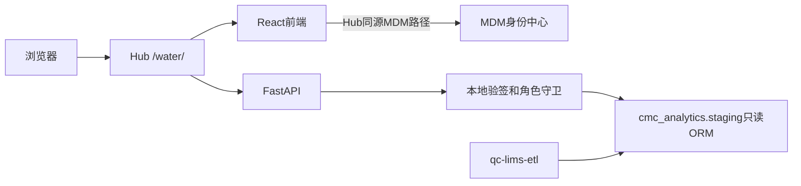

# 05 · 架构与数据模型

> **2026-10-09 已确认规则更新（v1.0，Mac 代码/测试/数据已验证）**：所有最终结果接口仅 Reviewed；兼容水系统 v1/v2 选择规则。微生物限度报告值 `<1` 单独派生绘图值 0，精确 1 为 1；原文、比较符、阈值和规则保留，0 不作实测统计。趋势及 PNG/表格导出统一使用 `plot_value`。第四表水系统仅保留最终结果键，过程数据保留在 raw。详见[变更记录](./changes/20261009-reviewed-water-results.md)。本轮 Linux 未发布，历史发布状态不代表 v2 已上线。

> 版本：0.8｜日期：2026-10-09｜状态：现行代码结构与一致性边界；后续设计明确标注。

## 0. 本轮两页实现

[两页整理设计](changes/20261009-two-page-dashboard.md)已按用户新指令实施：无筛选三卡片总览、独立comparison-groups趋势接口、删除三个专用功能/API，总览在一个只读事务中SQL聚合。位置/系统归属暂停，当前五表不增字段。以下按本轮最终代码描述，Linux服务仍为旧版。

## 1. 当前架构

技术栈与依赖见 backend/pyproject.toml、backend/uv.lock及frontend/package.json、frontend/pnpm-lock.yaml。没有业务写接口、独立数据库或本项目迁移链；不连接Oracle，不创建共享表。

## 2. 实际目录与责任

| 文件 | 职责 |
|---|---|
| backend/app/core.py | Settings、JWT身份和查看/导出守卫 |
| backend/app/db.py | 五表反射ORM、启动预检、只读事务、级联候选、结果读取 |
| backend/app/analysis.py | FilterSpec、日期、解析、来源键、比较组、计数和总览规则标识 |
| backend/app/main.py | 路由、上下文、错误/运行日志、总览/比较组/趋势、追溯和导出编排 |
| backend/app/export.py | matplotlib PNG、openpyxl Excel、CSV/JSONL/ZIP及manifest |
| frontend/src/main.tsx | 两页导航、趋势筛选/查询、ECharts、追溯和下载 |
| frontend/src/Overview.tsx、navigation.ts | 三卡片总览、两页URL与旧页面恢复；顶部黄色上下文提示按用户要求删除 |
| frontend/src/filters.ts | 筛选顺序、下游重置、候选显示 |
| frontend/src/transport.ts、api.ts | 401续期一次、错误处理、同源API与query序列化 |
| frontend/src/shared/cmabSession.ts | Hub会话副本，MDM刷新/退出/守卫 |
| backend/tests、frontend/tests | 隔离规则/API与传输/级联验证 |
| deploy/mac、deploy/linux | 开发启动与固定提交部署脚本 |

原规划的core/services/features分目录尚未采用；是否拆分由后续维护范围决定，不将目录规划描述为已实现。

## 3. 实际逻辑对象与规划对象

| 对象 | 当前承载 | 状态 |
|---|---|---|
| FilterSpec | Pydantic模型 | 已实现，请求契约见docs/07 |
| WaterResult | 五张staging反射ORM；完整列读取 | 已实现，只读 |
| NormalizedResult | normalize返回字典，保留源列并增加展示/解析字段 | 已实现；没有独立响应模型 |
| ComparisonGroup | 源字段数组编码，缺单位/内部ID追加来源键 | 已实现；定义见docs/04 |
| SamplingPointMapping | 样品/宽表六个当前主表映射字段 | 已消费；系统/回路/历史生效期未提供 |
| DataContext | context字典 | 已实现，截止/context_id未知，新鲜度未核实 |
| ChartSpec | ExportRequest.chart_spec字典 | 占位且不参与渲染；统一类型契约未实现（GAP-02） |
| ExportManifest | generate中的导出字典 | 已实现，ZIP写manifest及四文件哈希；Excel内嵌说明 |
| LimitDefinition | 无表、无模型 | 未实现；OP-02先确认 |
| 历史快照/持久审计 | 无本项目对象 | 用户已确认水系统mart不建历史快照；持久审计仍为OP-09独立事项 |

## 4. 当前一致性与后续目标

连接使用REPEATABLE READ和default_transaction_read_only；事务再次SET TRANSACTION READ ONLY。collection在同一事务读取结果与context；筛选候选与追溯各在只读事务内查询；总览SQL聚合与context同一事务返回。

当前context_id/source_cutoff始终为null。最小/最大趋势日期和最大_etl_loaded_at只是全授权水样范围的日期/装载线索；不能证明截止、手工修改/删除检测或跨接口一致性。前端分别请求各模块，没有可信数据版本比较。用户已确认水系统mart不建历史快照；若后续要求严格全页一致，优先设计同事务聚合读取，不将不可变历史版本作为本轮目标（OP-06/GAP-07）。

导出重新只读取数后收窄比较组，检查当前组完整规范化行的SHA256是否等于页面dataset_digest；非null的context_id或digest不符均返回409。digest只验证该组结果内容，不包括全部context元数据，也不是可重定位的快照ID。

取数完成释放事务再生成文件；PNG/Excel/CSV/JSONL来自同一固定结果集。前端ECharts和matplotlib分别渲染相同组/日期/类别，没有共享的类型化ChartSpec。PNG使用water_chart_v2；页面缩放不影响导出范围。不声明图像逐像素相同或长期可复现。

## 5. 读取、预检和限制

启动反射五张指定表，校验REQUIRED字段、SELECT可用、无INSERT/UPDATE/DELETE/TRUNCATE表权限及只读连接。宽表trend_dt/_etl_loaded_at要求带时区，dataset/replicateid要求Decimal。其余列不是全部都有类型校验（GAP-05）；已移除质量候选查询，不再使用其displayunits/enteredunits路径。

用户筛选以绑定参数ORM表达式查询，排序为完整结果键。趋势/比较组/导出读MAX_ROWS+1以检测超限，再规范化；趋势/导出仍先读FilterSpec全集再选组。总览COUNT DISTINCT在数据库执行，仅返回三类聚合，不受原文读取上限影响。当前没有数据库分页、通用未知规则诊断或新增可选列差异事件。

最小数据范围、总览统计与追溯边界见docs/03/07。新增共享结构须先盘点消费者，经cmc-schema-migrations发布，不因本轮文档改动新增迁移。

## 6. 日志现状与审计目标

已实现请求ID、path、actor、status、seconds运行日志和成功导出的actor/rows/kind事件。SQL和导出错误仅记类型等诊断信息，不输出密钥或连接串。

目标仍包括事件时间、筛选摘要、规则版本、结果数量、导出ID、完整成功/失败覆盖和留存责任。当前日志不完整，且未处理异常可能绕过请求结束日志；持久介质/防篡改不成立（OP-09/GAP-04）。不能把运行日志称为已完成受控审计。若后续需数据库审计，另设最小写权限，保持数据查询账号只读。

水系统mart采用普通视图及电导率μS/cm、TOCppb、pH无量纲的已确认设计，见[契约v0.3](11-water-mart-design.md)；四视图已在Mac创建、单位字段和源值已对账。现行看板仍读staging，尚未消费这些mart单位字段，Linux未发布。
