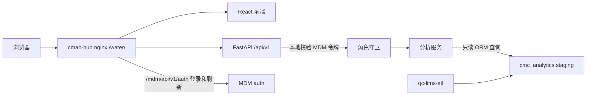

# 05 · 架构与数据模型

> 版本：0.4｜日期：2026-10-02｜状态：Mac 已实现，验收部分完成；Linux 未发布。

## 1. 工作架构



前端 React/TypeScript/Vite/Ant Design/React Query，图表 ECharts；后端 FastAPI/Pydantic/SQLAlchemy 2 async/asyncpg，uv 管理。确切依赖版本在编码时锁定。应用连接 PostgreSQL 分析库，浏览器不接触数据库凭据。

## 2. 代码组织工作设计

```text
backend/
  app/core/         配置、数据库、MDM 验签与角色守卫
  app/models/       既有 staging ORM 映射
  app/schemas/      类型化接口契约
  app/services/     结果规范化、比较组、汇总、追溯、导出
  app/api/v1/       业务路由
  tests/            隔离或 Mock 的必要验证
frontend/
  src/api/          API 客户端与响应类型
  src/shared/       Hub 会话母本、路径工具
  src/features/     总览、趋势、结果、质量明细
deploy/             Mac 启动/托管与 Linux 发布脚本
docs/               当前文档及未来验收/发布证据
```

目录尚未创建，结构可按实际实现简化。服务层复用筛选、规则与统计逻辑，页面与导出不各写一套口径。

## 3. 逻辑模型

| 对象 | 字段摘要 | 存储/来源 |
|---|---|---|
| WaterResult | 完整源键、样品/点位/方法、原值单位、状态日期与规则 | staging ORM 只读对象 |
| NormalizedResult | result_kind、numeric_value、operator、bound、解析说明、分析版本 | 从 WaterResult 派生，不覆盖 staging |
| ComparisonGroup | 水类型、取样点、方法版本/阶段、参数族、规范单位 | 查询与分析分组 |
| SamplingPointMapping | 源编号、名称、系统/回路/位置、生效期、来源、版本 | 权威源/分析映射归属 OP-01 |
| LimitDefinition | 限度类型、适用对象、比较符/值/单位、生效期和依据 | 先确认 OP-02，再确定是否需要存储 |
| DataContext | 环境、来源、查询时间、截止依据、规则版本、装载标记 | 预检和响应元数据；未知项明确为未知 |
| ChartSpec | 已解析日期、比较组、单位、点/标记、图例、已确认限度和展示版本 | 页面与服务端图像共用语义契约 |
| ExportManifest | 导出 ID/类型、操作者、筛选、分析版本、上下文、行数/图点数、生成时间及哈希 | 导出附带说明与审计事件 |

一期基础页面可只读查询既有 staging，无需新增业务表。若新增映射、限度配置、访问审计或版本快照表，归 `cmc_analytics` 相应 schema，先设计归属和消费者影响，再在 cmc-schema-migrations 创建迁移。本项目启动过程不能 `create_all` 创建共享结构。

## 4. 数据一致性与快照

Mac 先消费既有快照派生 staging。每个多查询响应使用只读一致性事务，工作设计为 REPEATABLE READ，确保计数与页面行来自同一数据库视图；连接释放和长查询超时要受控。

跨请求/跨页期间 staging 可能刷新，一次事务一致不等于整个页面或长期可复现。每个响应都返回 data_context 和 context_id；只有已核实可区分数据变更的标记才生成可比较的 context_id。单个 `_etl_loaded_at` 最大值只能作装载线索，不能保证检测到手工修正、删除或映射变化。标记须覆盖源结果、映射和分析规则，具体依据见 OP-06。

上下文可信时，前端比较各图表/列表响应的 context_id，变化则放弃混合结果并整体刷新。上下文未知时显示“一致性上下文未核实”，不声称跨接口同一快照。若需要页面各指标严格同时一致，使用聚合接口在同一只读事务内返回，或查询不可变数据版本；不能仅靠前端同时发请求保证。

PNG、Excel、CSV、保真 JSONL 与 manifest 使用同一次只读一致性读取所得的固定结果集和 ChartSpec。取数完成释放数据库事务，再渲染图像和写文件，不能分别为图和表重新查询。服务端 PNG 渲染器与前端 ECharts 共享日期、组别、单位、点/标记及限度语义；依赖和字体在 Mac/Linux 评估锁定，不要求实现库相同。只有不可变、可重新定位的数据版本才声明可复现；文件哈希本身不能证明来源数据库未变化。

Linux 常规趋势和正式报告的受控快照策略 OP-06 尚待决定，需符合白皮书 GMP 日常分析边界。不能把刷新型 staging 或 MAX(result_date) 命名为不可变快照/数据截止证明。

## 5. 查询与审计

- 只读查询账号和只读事务双重控制；授权范围优先限于五张 QC staging，追加其他表需说明用途并核实权限。
- 用户筛选转为类型化、绑定参数的 ORM 表达式；字段与排序白名单。追溯先由受限宽表定位目标再访问完整参数链，不能暴露跨域任意样品查询。
- 索引与分页依据实际计划和数据规模；分页采用稳定复合排序。缺失必需字段或类型不兼容时明确报错；新增可选列作为结构差异记录，不因无关新增列阻断已兼容查询。全字段 raw 抽取的严格新列校验仍由上游 ETL 负责。
- 工作设计记录 request_id、用户标识、事件类型、筛选摘要、结果数量、耗时、成功/失败、时间、规则版本。查询/拒绝/导出事件可先写结构化运行日志，最终留存级别与持久审计介质见 OP-09。
- 文件日志不等于不可篡改受控审计；若需数据库审计写入，采用独立最小写权限，不能扩大数据查询账号权限。
- 上游新鲜度按 QC 的具体 job_name 和成功范围核对。查询账号不能读 meta 时显示“新鲜度未核实”，不能回退取其他 job 的成功时间。

## 6. 功能前置条件

基础展示优先使用既有只读 staging；数据质量的候选核对同样查询这五表。完整检项追溯先利用 dataset 已有实例号，按 docs/03 验证选定关联。Linux 的受控快照读取应通过数据仓储层替换数据来源，并保留相同业务契约；具体快照结构和适配在 OP-06 定稿，不能仅增加环境变量就宣称已满足要求。

必需预检包括结构/类型、只读查询与权限、身份验签和角色配置；来源覆盖、数据质量和性能画像可作为受限诊断分批执行，避免每次服务重启重复做大范围扫描。就绪条件区分“可提供服务”和“指定数据范围已验收”。


## Mac 实施状态（2026-10-02）

V0.3 的工作设计和历史复核记录保留用于追踪；当前事实以 [Mac 验收记录](acceptance/mac-20261002.md) 和 docs/10 新决定为准。基础应用已运行，不能据此将所有验收项或 Linux 发布登记为通过。
